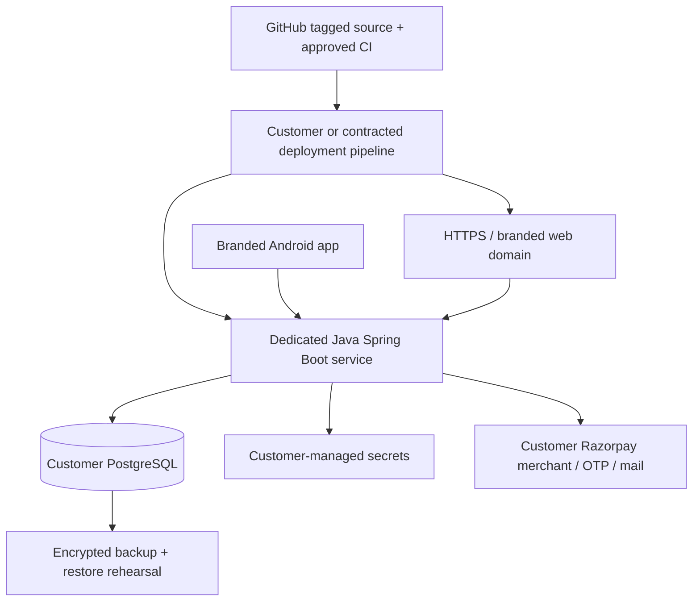
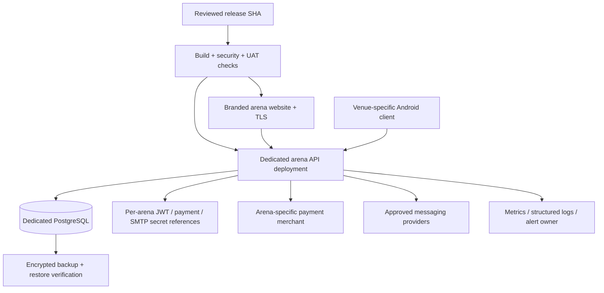
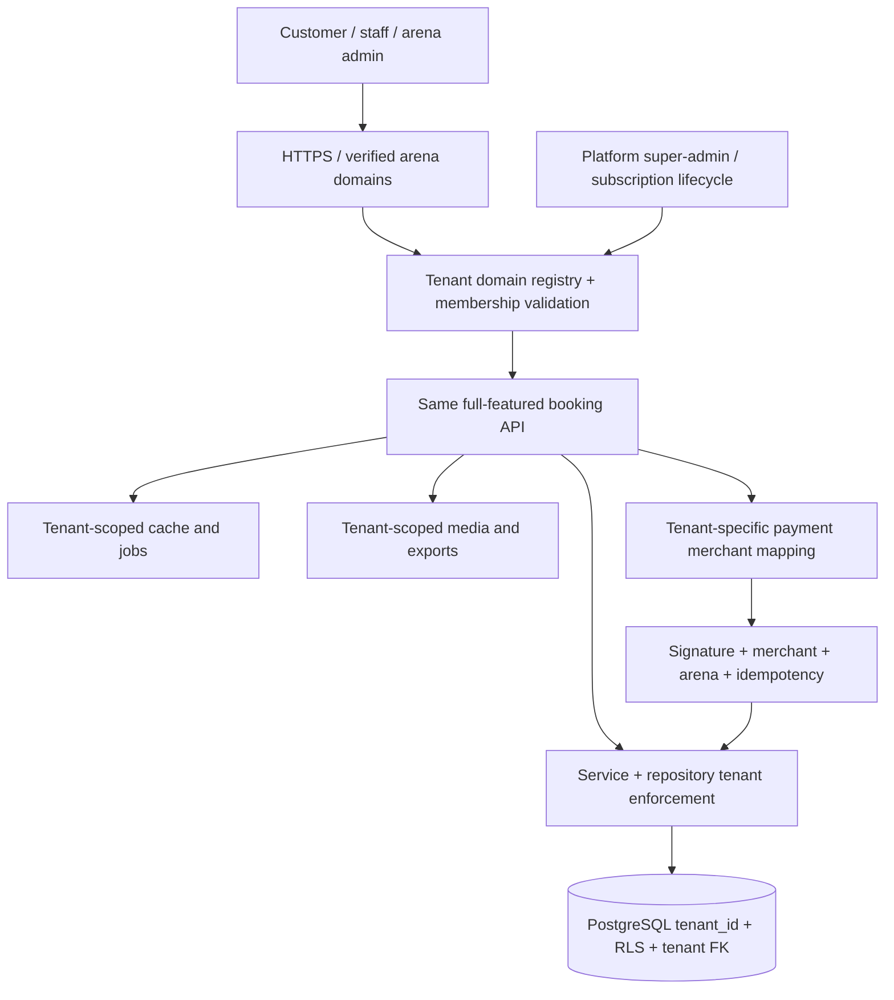

# Deployment diagrams, environments and release checklist

> Reference deployment topology, **not** a statement that Cloudflare, Northflank, Render, Neon or other providers are configured for PlayNexa. Verify actual DNS, hosting and credentials per arena.

## Customer-hosted (complete PlayNexa booking platform)



The customer or their IT provider is responsible for infrastructure, backups and patch scheduling under the support agreement. Product updates come from the same PlayNexa versioned source and must pass regression tests.

## PlayNexa-managed single-tenant



Varada Techworks operates hosting and maintenance. **No other arena may reuse this database, secret set or merchant keys.** The arena retains its branding and all booking features.

## Multi-tenant SaaS — target, currently blocked



**Not production-ready:** no end-to-end tenant-scoped database, auth, webhook, scheduled job, storage or export isolation has been proven. The existing Spring Boot safety gate must remain in place. Do not direct real customers into a shared database.

## Minimum per-environment inventory

| Domain | Environment / proof |
|---|---|
| Source | Immutable git SHA, release tag, CI test reports, application artifact checksum |
| Domains | Verified DNS, TLS certificate, CORS exact HTTPS origins |
| Backend | Java 21 runtime, health endpoints, host/service URL, region |
| Web | Build-time public arena metadata, API origin, HTTPS deployment |
| Database | PostgreSQL version, database per dedicated arena, Flyway history, backup and restoration |
| Authentication | Unique JWT signing key, access-token duration, OTP/MFA and staff permissions |
| Payments | Arena KYC/merchant, Razorpay API key references, webhook endpoint, reconciliation and refund tests |
| Notifications | Sender identity, SMTP/SMS/WhatsApp provider, delivery and opt-in policies |
| Android | Package ID, scheme, icons, signing certificate, app update policy, QR to correct arena domain |
| Observability | Correlation header, audit/error retention, alerts, incident escalation |
| Recovery | RTO/RPO agreed with owner, backup locations and tested restore procedure |

## Deployment gates

1. Approve release SHA and review database migration diff. Backup and test restoration on a copy.
2. Configure distinct DEV/UAT/PROD databases and secrets; never import Jnapanam live customer data.
3. Run all backend tests, web build, mobile typecheck, and static route audit.
4. Set `APP_ENV=production` (or active Spring `prod` profile) and pass the production configuration guard: explicit DB creds, JWT, short access expiry, real merchant, webhook secret, CORS HTTPS, no fixed OTP/mock payments.
5. Run migration validation and schema check against a **fresh staging PostgreSQL** database before the approved live migration.
6. Smoke test quote → hold → verified payment → booking confirmation → invoice → check-in → refund, including retries and negative cases.
7. Monitor error logs, webhook retries and payment/booking reconciliation; only then enable customer access.
8. If a deployment fails: stop new bookings (maintenance gate), preserve evidence and use a pre-approved forward fix or tested database restore. Do not delete Flyway history.

## Build commands (repository-based, verify dependencies first)

```bash
npm test
npm run audit:routes
mvn -f apps/backend/pom.xml test
cd apps/web && npm ci && npm run build
cd ../mobile && npm ci && npx tsc --noEmit
```

Local demo `npm run demo` is **synthetic**, and does not test the actual Spring Boot booking engine.
