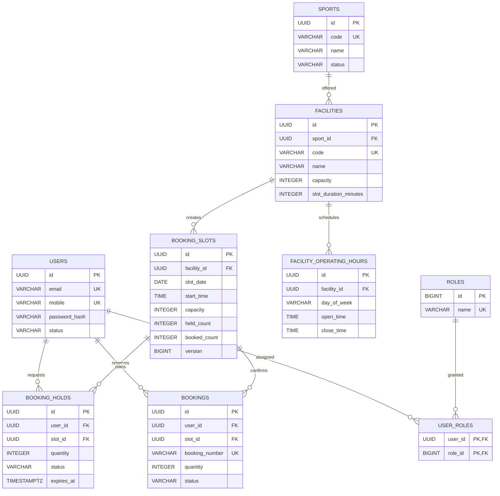
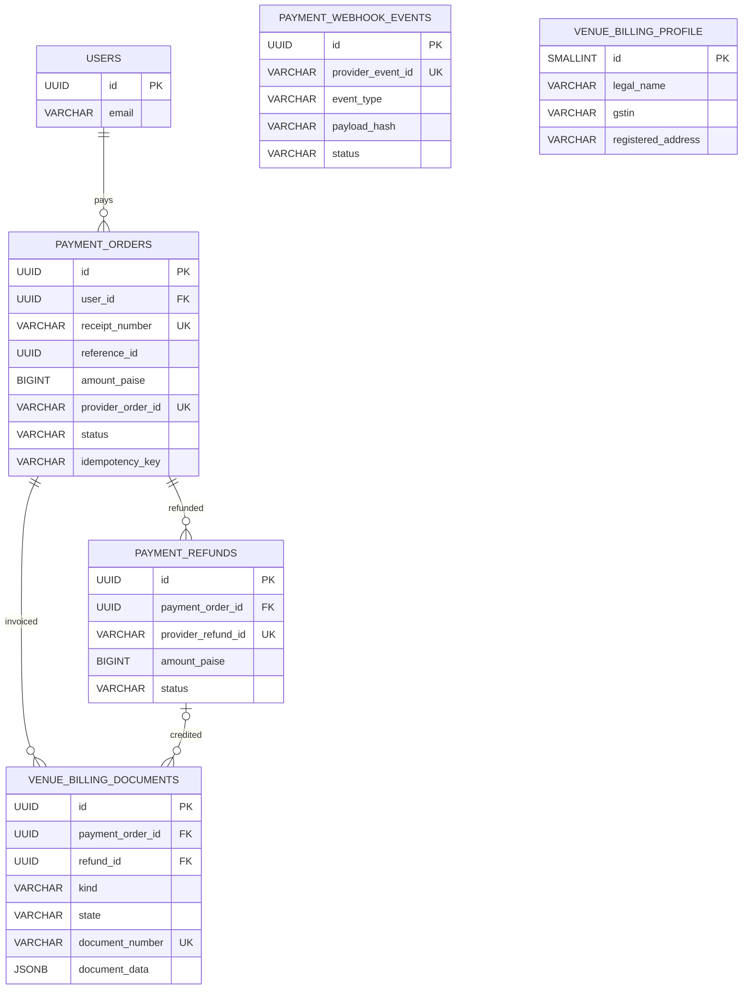
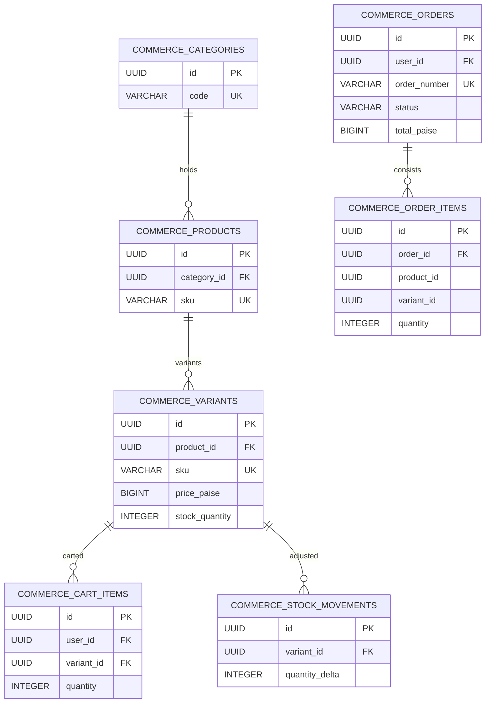
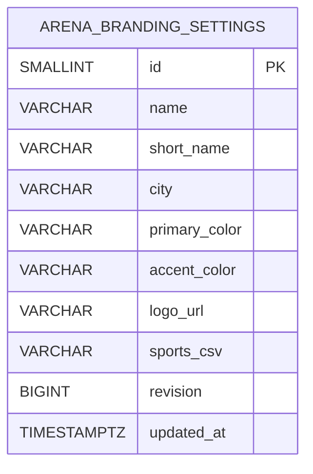
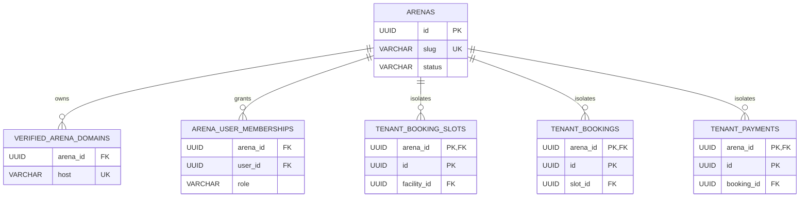

# Database ER diagrams — bookings, identity, payments, GST and commerce

> Extracted from the **committed baseline migration SQL**. Subsequent `ALTER TABLE` migrations may change the full physical schema. Treat this as a **logical ER**, verify actual constraints with `pg_dump --schema-only` and Flyway history. Never infer live schema or table counts from this page.

## Identity, facilities and booking inventory

**Source:** `V1__identity_schema.sql`, `V3__sports_facilities_schema.sql`, `V4__booking_schema.sql`. Booking capacity has a database check: `held_count + booked_count <= capacity`; unique slot key is `(facility_id, slot_date, start_time)`. These constraints supplement transactional locking/versioning and do not alone prove race-free booking.

## Payment, refund and invoicing

**Source:** `V7__payments_schema.sql`, `V49__billing_tax_documents.sql`. `PAYMENT_ORDERS.reference_id` is a polymorphic reference paired with purpose, **not a declared FK to bookings**. `PAYMENT_WEBHOOK_EVENTS` is deduplicated by provider event ID, rather than represented as an FK to a specific payment row in the original migration. Refund adjustments and tax snapshots are augmented by later migration files. Check actual schema before adding references.

## Commerce inventory and orders

**Source:** `V20__commerce_schema.sql`. `commerce_order_items.product_id` and `variant_id` are snapshot identifiers in the baseline DDL, without explicit FK declarations. Do not draw undocumented FK constraints.

## Dedicated arena branding

**Source:** PlayNexa `V60__playnexa_arena_branding_settings.sql`. Single row `id=1`; **not** a multi-tenant branding table. Multi-tenant design must use an immutable `arena_id` plus ownership constraints instead of putting different arenas into this table.

## Multi-tenant target schema (NOT DEPLOYED)

Composite foreign keys must include `arena_id` for every tenant-owned relationship. PostgreSQL RLS, application-level scope, signed user membership and tenant-specific webhook/merchant mapping are required. **Do not apply this sketch directly as a production migration.** No complete multi-tenant SQL migration exists yet.

See [source SQL catalogue](SCHEMA_INDEX.md) for every committed Flyway migration.
