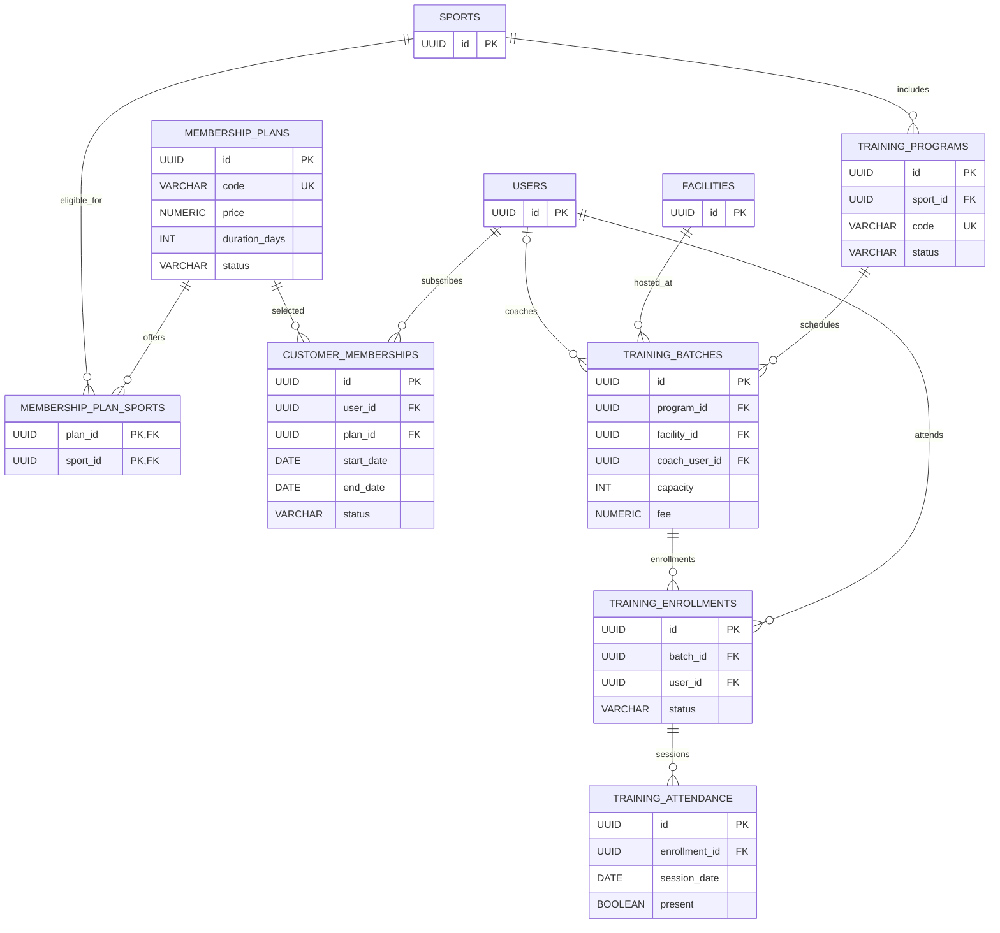
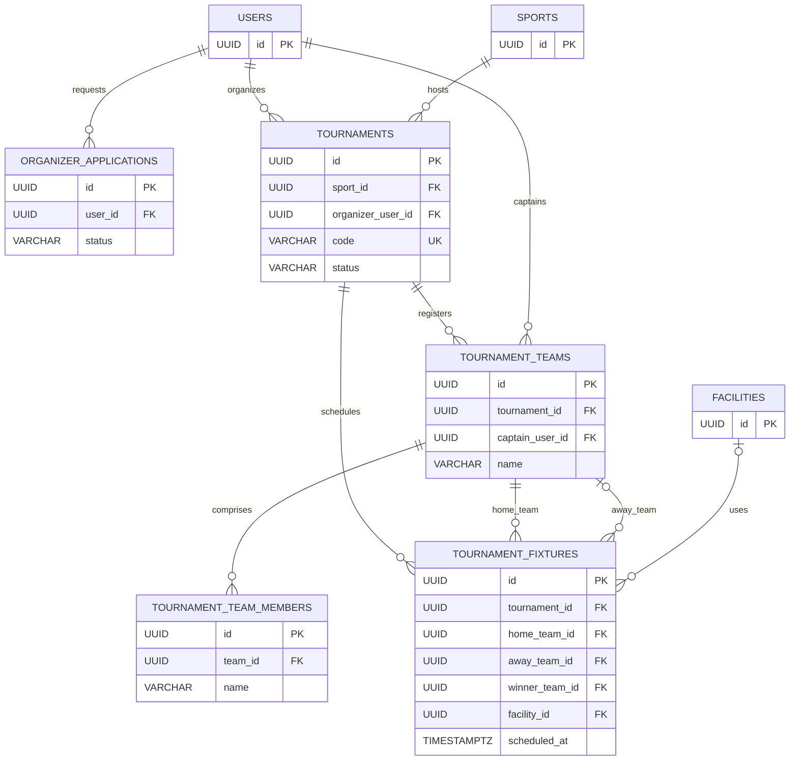
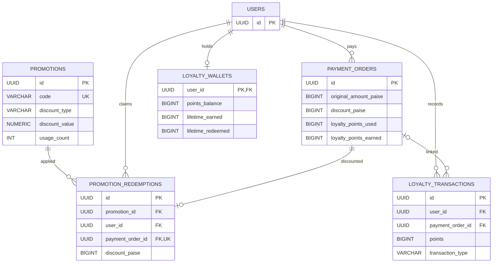
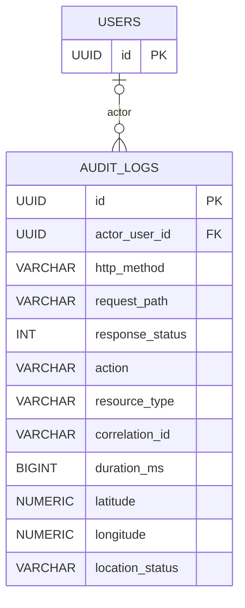

# PlayNexa extended entity-relationship models — memberships, coaching, tournaments, loyalty and audit

> **Source-derived on 2026-11-10.** Relationships below come from versioned Flyway SQL, not a live `pg_dump`; later migrations can add columns or constraints. These are logical ER diagrams, not executable database scripts. Shared SaaS remains prohibited until tenant scoping is complete.

See the [core booking/payment/tax/commerce ER](ER_BOOKING_PAYMENTS.md), [full migration catalogue](SCHEMA_INDEX.md), and [migration runbook](MIGRATION_RUNBOOK.md).

## 1. Membership and coaching

From `V5__membership_schema.sql` and `V6__training_coaching_schema.sql`.



**Important constraints:** membership plan duration > 0; training batch capacity > 0; training batch end date must not precede start date; one enrollment per batch/user; one attendance row per enrollment/session date. Verify updated policies and refund/accounting in the current application before relying on baseline constraints alone.

## 2. Tournaments and fixtures

From `V9__tournaments_schema.sql`.



**Important constraints:** one team name and captain per tournament; unique round/match number; nullable away team (bye), winner, and facility. Baseline foreign keys do **not** automatically prove that a fixture's team belongs to the same tournament; validate such cross-entity invariants in services and negative tests.

## 3. Promotions, loyalty and payment linkage

From `V16__promotions_and_loyalty.sql`.



**Important constraints:** promotion dates and usage limits, nonnegative loyalty balances, one promotion redemption per payment order. Refund adjustments can change earned/redeemed loyalty: audit subsequent migrations `V54__loyalty_refund_debt.sql` and business-service logic before settling accounts.

## 4. Activity and geolocation audit (conceptual from committed tables)

The existing `audit_logs` table has an immutable trigger in `V13__reports_audit_hardening.sql`; later `V37__audit_event_geolocation.sql` adds location evidence. It records HTTP status, correlation ID, actor when authenticated, request route and optional client-provided coordinates. **A self-reported GPS point is evidence of a claim, not trusted proof of physical presence.**



**Security:** log only sanitized paths; do not store bearer tokens, OTP, passwords, payment keys, PAN/identity data or untrusted forwarding headers as an identity source. Access to location and audit details must be role-scoped, with documented retention and deletion policy. Do not overwrite immutable audit rows.

## 5. Physical verification and handover

```bash
# Approved read-only PostgreSQL export (do not commit unreviewed DDL or secrets)
pg_dump --schema-only --no-owner --no-privileges "$DATABASE_URL" > schema-only.sql
# Compare Flyway history and indexed source before a migration
bash scripts/migrate-playnexa.sh plan
```

Use production migration approval and a *restored staging backup* before running the existing guarded `scripts/migrate-playnexa.sh migrate`; see the migration runbook. **Never copy or renumber an overlapping Jnapanam migration without a reviewed migration-lineage reconciliation.**
