# PlayNexa migration schema: Part 1

> SQL files 1–14 of 59, from `main` on 2026-11-09. **Source-derived partial schema, not live database schema.** **Shared SaaS is not production-ready** according to project release contract.

## Migration inventory
- [`V1__identity_schema.sql`](../../apps/backend/src/main/resources/db/migration/V1__identity_schema.sql)
- [`V2__align_refresh_token_hash_type.sql`](../../apps/backend/src/main/resources/db/migration/V2__align_refresh_token_hash_type.sql)
- [`V3__sports_facilities_schema.sql`](../../apps/backend/src/main/resources/db/migration/V3__sports_facilities_schema.sql)
- [`V4__booking_schema.sql`](../../apps/backend/src/main/resources/db/migration/V4__booking_schema.sql)
- [`V5__membership_schema.sql`](../../apps/backend/src/main/resources/db/migration/V5__membership_schema.sql)
- [`V6__training_coaching_schema.sql`](../../apps/backend/src/main/resources/db/migration/V6__training_coaching_schema.sql)
- [`V7__payments_schema.sql`](../../apps/backend/src/main/resources/db/migration/V7__payments_schema.sql)
- [`V8__notifications_schema.sql`](../../apps/backend/src/main/resources/db/migration/V8__notifications_schema.sql)
- [`V9__tournaments_schema.sql`](../../apps/backend/src/main/resources/db/migration/V9__tournaments_schema.sql)
- [`V10__administration_reporting.sql`](../../apps/backend/src/main/resources/db/migration/V10__administration_reporting.sql)
- [`V11__public_content_events.sql`](../../apps/backend/src/main/resources/db/migration/V11__public_content_events.sql)
- [`V12__customer_user_management.sql`](../../apps/backend/src/main/resources/db/migration/V12__customer_user_management.sql)
- [`V13__reports_audit_hardening.sql`](../../apps/backend/src/main/resources/db/migration/V13__reports_audit_hardening.sql)
- [`V14__backend_completion_workflows.sql`](../../apps/backend/src/main/resources/db/migration/V14__backend_completion_workflows.sql)

## New table relationships

```mermaid
erDiagram
    ROLES {
        BIGSERIAL id
        VARCHAR40 name
    }
    USERS {
        UUID id
        VARCHAR120 full_name
        VARCHAR180 email
        VARCHAR20 mobile
        VARCHAR255 password_hash
        VARCHAR30 status
    }
    USER_ROLES {
        UUID user_id
        BIGINT role_id
    }
    REFRESH_TOKENS {
        UUID id
        UUID user_id
        CHAR64 token_hash
        TIMESTAMPTZ expires_at
        TIMESTAMPTZ revoked_at
        TIMESTAMPTZ created_at
    }
    SPORTS {
        UUID id
        VARCHAR40 code
        VARCHAR100 name
        VARCHAR500 description
        VARCHAR60 icon_key
        INTEGER display_order
    }
    FACILITIES {
        UUID id
        UUID sport_id
        VARCHAR50 code
        VARCHAR120 name
        VARCHAR500 description
        VARCHAR160 location_label
    }
    FACILITY_OPERATING_HOURS {
        UUID id
        UUID facility_id
        VARCHAR10 day_of_week
        BOOLEAN closed
    }
    FACILITY_CLOSURES {
        UUID id
        UUID facility_id
        DATE closure_date
        VARCHAR250 reason
    }
    FACILITY_SCHEDULE_OVERRIDES {
        UUID id
        UUID facility_id
        DATE schedule_date
        VARCHAR20 availability
        INTEGER slot_duration_minutes
        INTEGER capacity
    }
    BOOKING_SLOTS {
        UUID id
        UUID facility_id
        DATE slot_date
        INTEGER capacity
        INTEGER held_count
        INTEGER booked_count
    }
    BOOKING_HOLDS {
        UUID id
        UUID user_id
        UUID slot_id
        INTEGER quantity
        VARCHAR20 status
        TIMESTAMPTZ expires_at
    }
    BOOKINGS {
        UUID id
        VARCHAR30 booking_number
        UUID user_id
        UUID slot_id
        INTEGER quantity
        VARCHAR20 status
    }
    MEMBERSHIP_PLANS {
        UUID id
        VARCHAR40 code
        VARCHAR120 name
        VARCHAR600 description
        INTEGER duration_days
        NUMERIC122 price
    }
    MEMBERSHIP_PLAN_SPORTS {
        UUID plan_id
        UUID sport_id
    }
    CUSTOMER_MEMBERSHIPS {
        UUID id
        UUID user_id
        UUID plan_id
        VARCHAR30 status
        DATE start_date
        DATE end_date
    }
    TRAINING_PROGRAMS {
        UUID id
        VARCHAR40 code
        UUID sport_id
        VARCHAR140 name
        VARCHAR700 description
        INTEGER min_age
    }
    TRAINING_BATCHES {
        UUID id
        UUID program_id
        UUID facility_id
        UUID coach_user_id
        VARCHAR140 name
        DATE start_date
    }
    TRAINING_ENROLLMENTS {
        UUID id
        UUID batch_id
        UUID user_id
        VARCHAR120 participant_name
        INTEGER participant_age
        VARCHAR20 status
    }
    TRAINING_ATTENDANCE {
        UUID id
        UUID enrollment_id
        DATE session_date
        BOOLEAN present
        TIMESTAMPTZ marked_at
    }
    PAYMENT_ORDERS {
        UUID id
        UUID user_id
        VARCHAR20 purpose
        UUID reference_id
        VARCHAR40 receipt_number
        BIGINT amount_paise
    }
    PAYMENT_REFUNDS {
        UUID id
        UUID payment_order_id
        VARCHAR120 provider_refund_id
        BIGINT amount_paise
        VARCHAR300 reason
        VARCHAR20 status
    }
    PAYMENT_WEBHOOK_EVENTS {
        UUID id
        VARCHAR160 provider_event_id
        VARCHAR80 event_type
        VARCHAR64 payload_hash
        VARCHAR20 status
        TIMESTAMPTZ processed_at
    }
    NOTIFICATION_TEMPLATES {
        UUID id
        VARCHAR60 code
        VARCHAR20 channel
        VARCHAR180 subject
        TEXT body
        BOOLEAN active
    }
    NOTIFICATION_PREFERENCES {
        UUID user_id
        BOOLEAN email_enabled
        BOOLEAN sms_enabled
        BOOLEAN push_enabled
        TIMESTAMPTZ updated_at
    }
    NOTIFICATIONS {
        UUID id
        UUID user_id
        VARCHAR20 channel
        VARCHAR40 category
        VARCHAR180 subject
        TEXT message
    }
    USERS ||--o{ USER_ROLES : references
    ROLES ||--o{ USER_ROLES : references
    USERS ||--o{ REFRESH_TOKENS : references
    SPORTS ||--o{ FACILITIES : references
    FACILITIES ||--o{ FACILITY_OPERATING_HOURS : references
    FACILITIES ||--o{ FACILITY_CLOSURES : references
    FACILITIES ||--o{ FACILITY_SCHEDULE_OVERRIDES : references
    FACILITIES ||--o{ BOOKING_SLOTS : references
    USERS ||--o{ BOOKING_HOLDS : references
    BOOKING_SLOTS ||--o{ BOOKING_HOLDS : references
    USERS ||--o{ BOOKINGS : references
    BOOKING_SLOTS ||--o{ BOOKINGS : references
    MEMBERSHIP_PLANS ||--o{ MEMBERSHIP_PLAN_SPORTS : references
    SPORTS ||--o{ MEMBERSHIP_PLAN_SPORTS : references
    USERS ||--o{ CUSTOMER_MEMBERSHIPS : references
    MEMBERSHIP_PLANS ||--o{ CUSTOMER_MEMBERSHIPS : references
    SPORTS ||--o{ TRAINING_PROGRAMS : references
    TRAINING_PROGRAMS ||--o{ TRAINING_BATCHES : references
    FACILITIES ||--o{ TRAINING_BATCHES : references
    USERS ||--o{ TRAINING_BATCHES : references
```

## Table / column dictionary
### `roles`
[Original migration](../../apps/backend/src/main/resources/db/migration/V1__identity_schema.sql)

| Column | DDL type |
|---|---|
| `id` | `BIGSERIAL` |
| `name` | `VARCHAR(40)` |

### `users`
[Original migration](../../apps/backend/src/main/resources/db/migration/V1__identity_schema.sql)

| Column | DDL type |
|---|---|
| `id` | `UUID` |
| `full_name` | `VARCHAR(120)` |
| `email` | `VARCHAR(180)` |
| `mobile` | `VARCHAR(20)` |
| `password_hash` | `VARCHAR(255)` |
| `status` | `VARCHAR(30)` |
| `created_at` | `TIMESTAMPTZ` |
| `updated_at` | `TIMESTAMPTZ` |

### `user_roles`
[Original migration](../../apps/backend/src/main/resources/db/migration/V1__identity_schema.sql)

| Column | DDL type |
|---|---|
| `user_id` | `UUID` |
| `role_id` | `BIGINT` |

### `refresh_tokens`
[Original migration](../../apps/backend/src/main/resources/db/migration/V1__identity_schema.sql)

| Column | DDL type |
|---|---|
| `id` | `UUID` |
| `user_id` | `UUID` |
| `token_hash` | `CHAR(64)` |
| `expires_at` | `TIMESTAMPTZ` |
| `revoked_at` | `TIMESTAMPTZ` |
| `created_at` | `TIMESTAMPTZ` |

### `sports`
[Original migration](../../apps/backend/src/main/resources/db/migration/V3__sports_facilities_schema.sql)

| Column | DDL type |
|---|---|
| `id` | `UUID` |
| `code` | `VARCHAR(40)` |
| `name` | `VARCHAR(100)` |
| `description` | `VARCHAR(500)` |
| `icon_key` | `VARCHAR(60)` |
| `display_order` | `INTEGER` |
| `status` | `VARCHAR(30)` |
| `suspended_from` | `DATE` |
| `suspended_until` | `DATE` |
| `status_reason` | `VARCHAR(250)` |
| `created_at` | `TIMESTAMPTZ` |
| `updated_at` | `TIMESTAMPTZ` |

### `facilities`
[Original migration](../../apps/backend/src/main/resources/db/migration/V3__sports_facilities_schema.sql)

| Column | DDL type |
|---|---|
| `id` | `UUID` |
| `sport_id` | `UUID` |
| `code` | `VARCHAR(50)` |
| `name` | `VARCHAR(120)` |
| `description` | `VARCHAR(500)` |
| `location_label` | `VARCHAR(160)` |
| `slot_duration_minutes` | `INTEGER` |
| `capacity` | `INTEGER` |
| `status` | `VARCHAR(30)` |
| `suspended_from` | `DATE` |
| `suspended_until` | `DATE` |
| `status_reason` | `VARCHAR(250)` |
| `created_at` | `TIMESTAMPTZ` |
| `updated_at` | `TIMESTAMPTZ` |

### `facility_operating_hours`
[Original migration](../../apps/backend/src/main/resources/db/migration/V3__sports_facilities_schema.sql)

| Column | DDL type |
|---|---|
| `id` | `UUID` |
| `facility_id` | `UUID` |
| `day_of_week` | `VARCHAR(10)` |
| `closed` | `BOOLEAN` |

### `facility_closures`
[Original migration](../../apps/backend/src/main/resources/db/migration/V3__sports_facilities_schema.sql)

| Column | DDL type |
|---|---|
| `id` | `UUID` |
| `facility_id` | `UUID` |
| `closure_date` | `DATE` |
| `reason` | `VARCHAR(250)` |

### `facility_schedule_overrides`
[Original migration](../../apps/backend/src/main/resources/db/migration/V3__sports_facilities_schema.sql)

| Column | DDL type |
|---|---|
| `id` | `UUID` |
| `facility_id` | `UUID` |
| `schedule_date` | `DATE` |
| `availability` | `VARCHAR(20)` |
| `slot_duration_minutes` | `INTEGER` |
| `capacity` | `INTEGER` |
| `reason` | `VARCHAR(250)` |

### `booking_slots`
[Original migration](../../apps/backend/src/main/resources/db/migration/V4__booking_schema.sql)

| Column | DDL type |
|---|---|
| `id` | `UUID` |
| `facility_id` | `UUID` |
| `slot_date` | `DATE` |
| `capacity` | `INTEGER` |
| `held_count` | `INTEGER` |
| `booked_count` | `INTEGER` |
| `version` | `BIGINT` |
| `created_at` | `TIMESTAMPTZ` |

### `booking_holds`
[Original migration](../../apps/backend/src/main/resources/db/migration/V4__booking_schema.sql)

| Column | DDL type |
|---|---|
| `id` | `UUID` |
| `user_id` | `UUID` |
| `slot_id` | `UUID` |
| `quantity` | `INTEGER` |
| `status` | `VARCHAR(20)` |
| `expires_at` | `TIMESTAMPTZ` |
| `created_at` | `TIMESTAMPTZ` |
| `updated_at` | `TIMESTAMPTZ` |

### `bookings`
[Original migration](../../apps/backend/src/main/resources/db/migration/V4__booking_schema.sql)

| Column | DDL type |
|---|---|
| `id` | `UUID` |
| `booking_number` | `VARCHAR(30)` |
| `user_id` | `UUID` |
| `slot_id` | `UUID` |
| `quantity` | `INTEGER` |
| `status` | `VARCHAR(20)` |
| `confirmed_at` | `TIMESTAMPTZ` |
| `cancelled_at` | `TIMESTAMPTZ` |

### `membership_plans`
[Original migration](../../apps/backend/src/main/resources/db/migration/V5__membership_schema.sql)

| Column | DDL type |
|---|---|
| `id` | `UUID` |
| `code` | `VARCHAR(40)` |
| `name` | `VARCHAR(120)` |
| `description` | `VARCHAR(600)` |
| `duration_days` | `INTEGER` |
| `price` | `NUMERIC(12,2)` |
| `daily_booking_limit` | `INTEGER` |
| `monthly_booking_limit` | `INTEGER` |
| `status` | `VARCHAR(20)` |
| `created_at` | `TIMESTAMPTZ` |
| `updated_at` | `TIMESTAMPTZ` |

### `membership_plan_sports`
[Original migration](../../apps/backend/src/main/resources/db/migration/V5__membership_schema.sql)

| Column | DDL type |
|---|---|
| `plan_id` | `UUID` |
| `sport_id` | `UUID` |

### `customer_memberships`
[Original migration](../../apps/backend/src/main/resources/db/migration/V5__membership_schema.sql)

| Column | DDL type |
|---|---|
| `id` | `UUID` |
| `user_id` | `UUID` |
| `plan_id` | `UUID` |
| `status` | `VARCHAR(30)` |
| `start_date` | `DATE` |
| `end_date` | `DATE` |
| `subscribed_at` | `TIMESTAMPTZ` |
| `activated_at` | `TIMESTAMPTZ` |
| `updated_at` | `TIMESTAMPTZ` |
| `status_reason` | `VARCHAR(250)` |

### `training_programs`
[Original migration](../../apps/backend/src/main/resources/db/migration/V6__training_coaching_schema.sql)

| Column | DDL type |
|---|---|
| `id` | `UUID` |
| `code` | `VARCHAR(40)` |
| `sport_id` | `UUID` |
| `name` | `VARCHAR(140)` |
| `description` | `VARCHAR(700)` |
| `min_age` | `INTEGER` |
| `max_age` | `INTEGER` |
| `level` | `VARCHAR(30)` |
| `status` | `VARCHAR(20)` |
| `created_at` | `TIMESTAMPTZ` |
| `updated_at` | `TIMESTAMPTZ` |

### `training_batches`
[Original migration](../../apps/backend/src/main/resources/db/migration/V6__training_coaching_schema.sql)

| Column | DDL type |
|---|---|
| `id` | `UUID` |
| `program_id` | `UUID` |
| `facility_id` | `UUID` |
| `coach_user_id` | `UUID` |
| `name` | `VARCHAR(140)` |
| `start_date` | `DATE` |
| `end_date` | `DATE` |
| `days_of_week` | `VARCHAR(80)` |
| `capacity` | `INTEGER` |
| `fee` | `NUMERIC(12,2)` |
| `status` | `VARCHAR(20)` |
| `version` | `BIGINT` |
| `created_at` | `TIMESTAMPTZ` |
| `updated_at` | `TIMESTAMPTZ` |

### `training_enrollments`
[Original migration](../../apps/backend/src/main/resources/db/migration/V6__training_coaching_schema.sql)

| Column | DDL type |
|---|---|
| `id` | `UUID` |
| `batch_id` | `UUID` |
| `user_id` | `UUID` |
| `participant_name` | `VARCHAR(120)` |
| `participant_age` | `INTEGER` |
| `status` | `VARCHAR(20)` |
| `enrolled_at` | `TIMESTAMPTZ` |
| `cancelled_at` | `TIMESTAMPTZ` |

### `training_attendance`
[Original migration](../../apps/backend/src/main/resources/db/migration/V6__training_coaching_schema.sql)

| Column | DDL type |
|---|---|
| `id` | `UUID` |
| `enrollment_id` | `UUID` |
| `session_date` | `DATE` |
| `present` | `BOOLEAN` |
| `marked_at` | `TIMESTAMPTZ` |

### `payment_orders`
[Original migration](../../apps/backend/src/main/resources/db/migration/V7__payments_schema.sql)

| Column | DDL type |
|---|---|
| `id` | `UUID` |
| `user_id` | `UUID` |
| `purpose` | `VARCHAR(20)` |
| `reference_id` | `UUID` |
| `receipt_number` | `VARCHAR(40)` |
| `amount_paise` | `BIGINT` |
| `currency` | `VARCHAR(3)` |
| `provider` | `VARCHAR(20)` |
| `provider_order_id` | `VARCHAR(120)` |
| `provider_payment_id` | `VARCHAR(120)` |
| `status` | `VARCHAR(30)` |
| `idempotency_key` | `VARCHAR(100)` |
| `paid_at` | `TIMESTAMPTZ` |
| `created_at` | `TIMESTAMPTZ` |
| `updated_at` | `TIMESTAMPTZ` |
| `version` | `BIGINT` |

### `payment_refunds`
[Original migration](../../apps/backend/src/main/resources/db/migration/V7__payments_schema.sql)

| Column | DDL type |
|---|---|
| `id` | `UUID` |
| `payment_order_id` | `UUID` |
| `provider_refund_id` | `VARCHAR(120)` |
| `amount_paise` | `BIGINT` |
| `reason` | `VARCHAR(300)` |
| `status` | `VARCHAR(20)` |
| `requested_at` | `TIMESTAMPTZ` |
| `processed_at` | `TIMESTAMPTZ` |

### `payment_webhook_events`
[Original migration](../../apps/backend/src/main/resources/db/migration/V7__payments_schema.sql)

| Column | DDL type |
|---|---|
| `id` | `UUID` |
| `provider_event_id` | `VARCHAR(160)` |
| `event_type` | `VARCHAR(80)` |
| `payload_hash` | `VARCHAR(64)` |
| `status` | `VARCHAR(20)` |
| `processed_at` | `TIMESTAMPTZ` |

### `notification_templates`
[Original migration](../../apps/backend/src/main/resources/db/migration/V8__notifications_schema.sql)

| Column | DDL type |
|---|---|
| `id` | `UUID` |
| `code` | `VARCHAR(60)` |
| `channel` | `VARCHAR(20)` |
| `subject` | `VARCHAR(180)` |
| `body` | `TEXT` |
| `active` | `BOOLEAN` |
| `created_at` | `TIMESTAMPTZ` |
| `updated_at` | `TIMESTAMPTZ` |

### `notification_preferences`
[Original migration](../../apps/backend/src/main/resources/db/migration/V8__notifications_schema.sql)

| Column | DDL type |
|---|---|
| `user_id` | `UUID` |
| `email_enabled` | `BOOLEAN` |
| `sms_enabled` | `BOOLEAN` |
| `push_enabled` | `BOOLEAN` |
| `updated_at` | `TIMESTAMPTZ` |

### `notifications`
[Original migration](../../apps/backend/src/main/resources/db/migration/V8__notifications_schema.sql)

| Column | DDL type |
|---|---|
| `id` | `UUID` |
| `user_id` | `UUID` |
| `channel` | `VARCHAR(20)` |
| `category` | `VARCHAR(40)` |
| `subject` | `VARCHAR(180)` |
| `message` | `TEXT` |
| `status` | `VARCHAR(20)` |
| `attempts` | `INTEGER` |
| `provider_message_id` | `VARCHAR(160)` |
| `last_error` | `VARCHAR(500)` |
| `read_at` | `TIMESTAMPTZ` |
| `created_at` | `TIMESTAMPTZ` |
| `sent_at` | `TIMESTAMPTZ` |
| `next_attempt_at` | `TIMESTAMPTZ` |

### `organizer_applications`
[Original migration](../../apps/backend/src/main/resources/db/migration/V9__tournaments_schema.sql)

| Column | DDL type |
|---|---|
| `id` | `UUID` |
| `user_id` | `UUID` |
| `organization_name` | `VARCHAR(160)` |
| `experience` | `TEXT` |
| `contact_number` | `VARCHAR(20)` |
| `status` | `VARCHAR(20)` |
| `review_note` | `VARCHAR(300)` |
| `applied_at` | `TIMESTAMPTZ` |
| `reviewed_at` | `TIMESTAMPTZ` |

### `tournaments`
[Original migration](../../apps/backend/src/main/resources/db/migration/V9__tournaments_schema.sql)

| Column | DDL type |
|---|---|
| `id` | `UUID` |
| `code` | `VARCHAR(40)` |
| `name` | `VARCHAR(160)` |
| `description` | `TEXT` |
| `sport_id` | `UUID` |
| `organizer_user_id` | `UUID` |
| `format` | `VARCHAR(30)` |
| `status` | `VARCHAR(30)` |
| `registration_opens` | `DATE` |
| `registration_closes` | `DATE` |
| `start_date` | `DATE` |
| `end_date` | `DATE` |
| `team_size` | `INTEGER` |
| `max_teams` | `INTEGER` |
| `entry_fee` | `NUMERIC(12,2)` |
| `created_at` | `TIMESTAMPTZ` |
| `updated_at` | `TIMESTAMPTZ` |

### `tournament_teams`
[Original migration](../../apps/backend/src/main/resources/db/migration/V9__tournaments_schema.sql)

| Column | DDL type |
|---|---|
| `id` | `UUID` |
| `tournament_id` | `UUID` |
| `captain_user_id` | `UUID` |
| `name` | `VARCHAR(120)` |
| `status` | `VARCHAR(20)` |
| `registered_at` | `TIMESTAMPTZ` |

### `tournament_team_members`
[Original migration](../../apps/backend/src/main/resources/db/migration/V9__tournaments_schema.sql)

| Column | DDL type |
|---|---|
| `id` | `UUID` |
| `team_id` | `UUID` |
| `name` | `VARCHAR(120)` |
| `email` | `VARCHAR(180)` |
| `mobile` | `VARCHAR(20)` |
| `created_at` | `TIMESTAMPTZ` |

### `tournament_fixtures`
[Original migration](../../apps/backend/src/main/resources/db/migration/V9__tournaments_schema.sql)

| Column | DDL type |
|---|---|
| `id` | `UUID` |
| `tournament_id` | `UUID` |
| `round_number` | `INTEGER` |
| `match_number` | `INTEGER` |
| `home_team_id` | `UUID` |
| `away_team_id` | `UUID` |
| `facility_id` | `UUID` |
| `scheduled_at` | `TIMESTAMPTZ` |
| `home_score` | `INTEGER` |
| `away_score` | `INTEGER` |
| `winner_team_id` | `UUID` |
| `status` | `VARCHAR(20)` |
| `updated_at` | `TIMESTAMPTZ` |

### `audit_logs`
[Original migration](../../apps/backend/src/main/resources/db/migration/V10__administration_reporting.sql)

| Column | DDL type |
|---|---|
| `id` | `UUID` |
| `actor_user_id` | `UUID` |
| `http_method` | `VARCHAR(10)` |
| `request_path` | `VARCHAR(300)` |
| `response_status` | `INTEGER` |
| `remote_address` | `VARCHAR(80)` |
| `occurred_at` | `TIMESTAMPTZ` |

### `public_events`
[Original migration](../../apps/backend/src/main/resources/db/migration/V11__public_content_events.sql)

| Column | DDL type |
|---|---|
| `id` | `UUID` |
| `slug` | `VARCHAR(100)` |
| `title` | `VARCHAR(180)` |
| `description` | `TEXT` |
| `event_type` | `VARCHAR(30)` |
| `sport_id` | `UUID` |
| `facility_id` | `UUID` |
| `starts_at` | `TIMESTAMPTZ` |
| `ends_at` | `TIMESTAMPTZ` |
| `registration_url` | `VARCHAR(500)` |
| `image_url` | `VARCHAR(500)` |
| `capacity` | `INTEGER` |
| `status` | `VARCHAR(20)` |
| `featured` | `BOOLEAN` |
| `display_order` | `INTEGER` |
| `created_at` | `TIMESTAMPTZ` |
| `updated_at` | `TIMESTAMPTZ` |

### `announcements`
[Original migration](../../apps/backend/src/main/resources/db/migration/V11__public_content_events.sql)

| Column | DDL type |
|---|---|
| `id` | `UUID` |
| `title` | `VARCHAR(180)` |
| `body` | `TEXT` |
| `priority` | `INTEGER` |
| `publish_from` | `TIMESTAMPTZ` |
| `publish_until` | `TIMESTAMPTZ` |
| `status` | `VARCHAR(20)` |
| `created_at` | `TIMESTAMPTZ` |
| `updated_at` | `TIMESTAMPTZ` |

### `gallery_items`
[Original migration](../../apps/backend/src/main/resources/db/migration/V11__public_content_events.sql)

| Column | DDL type |
|---|---|
| `id` | `UUID` |
| `title` | `VARCHAR(180)` |
| `media_type` | `VARCHAR(20)` |
| `media_url` | `VARCHAR(500)` |
| `thumbnail_url` | `VARCHAR(500)` |
| `alt_text` | `VARCHAR(250)` |
| `sport_id` | `UUID` |
| `published` | `BOOLEAN` |
| `display_order` | `INTEGER` |
| `created_at` | `TIMESTAMPTZ` |

### `content_pages`
[Original migration](../../apps/backend/src/main/resources/db/migration/V11__public_content_events.sql)

| Column | DDL type |
|---|---|
| `id` | `UUID` |
| `slug` | `VARCHAR(80)` |
| `title` | `VARCHAR(180)` |
| `summary` | `VARCHAR(500)` |
| `body` | `TEXT` |
| `status` | `VARCHAR(20)` |
| `updated_at` | `TIMESTAMPTZ` |

### `contact_inquiries`
[Original migration](../../apps/backend/src/main/resources/db/migration/V11__public_content_events.sql)

| Column | DDL type |
|---|---|
| `id` | `UUID` |
| `name` | `VARCHAR(120)` |
| `email` | `VARCHAR(180)` |
| `mobile` | `VARCHAR(20)` |
| `subject` | `VARCHAR(180)` |
| `message` | `TEXT` |
| `status` | `VARCHAR(20)` |
| `admin_note` | `VARCHAR(500)` |
| `created_at` | `TIMESTAMPTZ` |
| `resolved_at` | `TIMESTAMPTZ` |

### `user_admin_notes`
[Original migration](../../apps/backend/src/main/resources/db/migration/V12__customer_user_management.sql)

| Column | DDL type |
|---|---|
| `id` | `UUID` |
| `user_id` | `UUID` |
| `author_user_id` | `UUID` |
| `note` | `VARCHAR(1000)` |
| `created_at` | `TIMESTAMPTZ` |

### `user_tags`
[Original migration](../../apps/backend/src/main/resources/db/migration/V12__customer_user_management.sql)

| Column | DDL type |
|---|---|
| `user_id` | `UUID` |
| `tag` | `VARCHAR(50)` |

### `password_reset_tokens`
[Original migration](../../apps/backend/src/main/resources/db/migration/V14__backend_completion_workflows.sql)

| Column | DDL type |
|---|---|
| `id` | `UUID` |
| `user_id` | `UUID` |
| `token_hash` | `VARCHAR(64)` |
| `expires_at` | `TIMESTAMPTZ` |
| `used_at` | `TIMESTAMPTZ` |
| `created_at` | `TIMESTAMPTZ` |

## Added columns
| Table | Column | Type | Migration |
|---|---|---|---|
| `facilities` | `booking_price` | `NUMERIC` | [SQL](../../apps/backend/src/main/resources/db/migration/V7__payments_schema.sql) |
| `bookings` | `checked_in_at` | `TIMESTAMPTZ` | [SQL](../../apps/backend/src/main/resources/db/migration/V10__administration_reporting.sql) |
| `bookings` | `checked_in_by` | `UUID` | [SQL](../../apps/backend/src/main/resources/db/migration/V10__administration_reporting.sql) |
| `users` | `address_line` | `VARCHAR` | [SQL](../../apps/backend/src/main/resources/db/migration/V12__customer_user_management.sql) |
| `users` | `city` | `VARCHAR` | [SQL](../../apps/backend/src/main/resources/db/migration/V12__customer_user_management.sql) |
| `users` | `state` | `VARCHAR` | [SQL](../../apps/backend/src/main/resources/db/migration/V12__customer_user_management.sql) |
| `users` | `postal_code` | `VARCHAR` | [SQL](../../apps/backend/src/main/resources/db/migration/V12__customer_user_management.sql) |
| `users` | `emergency_contact_name` | `VARCHAR` | [SQL](../../apps/backend/src/main/resources/db/migration/V12__customer_user_management.sql) |
| `users` | `emergency_contact_mobile` | `VARCHAR` | [SQL](../../apps/backend/src/main/resources/db/migration/V12__customer_user_management.sql) |
| `users` | `force_password_change` | `BOOLEAN` | [SQL](../../apps/backend/src/main/resources/db/migration/V12__customer_user_management.sql) |
| `audit_logs` | `action` | `VARCHAR` | [SQL](../../apps/backend/src/main/resources/db/migration/V13__reports_audit_hardening.sql) |
| `audit_logs` | `resource_type` | `VARCHAR` | [SQL](../../apps/backend/src/main/resources/db/migration/V13__reports_audit_hardening.sql) |
| `audit_logs` | `resource_id` | `VARCHAR` | [SQL](../../apps/backend/src/main/resources/db/migration/V13__reports_audit_hardening.sql) |
| `audit_logs` | `query_string` | `VARCHAR` | [SQL](../../apps/backend/src/main/resources/db/migration/V13__reports_audit_hardening.sql) |
| `audit_logs` | `correlation_id` | `VARCHAR` | [SQL](../../apps/backend/src/main/resources/db/migration/V13__reports_audit_hardening.sql) |
| `audit_logs` | `user_agent` | `VARCHAR` | [SQL](../../apps/backend/src/main/resources/db/migration/V13__reports_audit_hardening.sql) |
| `audit_logs` | `duration_ms` | `BIGINT` | [SQL](../../apps/backend/src/main/resources/db/migration/V13__reports_audit_hardening.sql) |
| `audit_logs` | `successful` | `BOOLEAN` | [SQL](../../apps/backend/src/main/resources/db/migration/V13__reports_audit_hardening.sql) |
| `bookings` | `payment_expires_at` | `TIMESTAMPTZ` | [SQL](../../apps/backend/src/main/resources/db/migration/V14__backend_completion_workflows.sql) |
| `bookings` | `payment_completed_at` | `TIMESTAMPTZ` | [SQL](../../apps/backend/src/main/resources/db/migration/V14__backend_completion_workflows.sql) |
| `bookings` | `status_reason` | `VARCHAR` | [SQL](../../apps/backend/src/main/resources/db/migration/V14__backend_completion_workflows.sql) |
| `customer_memberships` | `payment_expires_at` | `TIMESTAMPTZ` | [SQL](../../apps/backend/src/main/resources/db/migration/V14__backend_completion_workflows.sql) |
| `training_enrollments` | `payment_expires_at` | `TIMESTAMPTZ` | [SQL](../../apps/backend/src/main/resources/db/migration/V14__backend_completion_workflows.sql) |
| `training_enrollments` | `payment_completed_at` | `TIMESTAMPTZ` | [SQL](../../apps/backend/src/main/resources/db/migration/V14__backend_completion_workflows.sql) |
| `tournament_teams` | `payment_expires_at` | `TIMESTAMPTZ` | [SQL](../../apps/backend/src/main/resources/db/migration/V14__backend_completion_workflows.sql) |
| `tournament_teams` | `payment_completed_at` | `TIMESTAMPTZ` | [SQL](../../apps/backend/src/main/resources/db/migration/V14__backend_completion_workflows.sql) |

**Limits:** constraints/indexes/renames/triggers may be omitted; verify `pg_dump --schema-only` and `flyway_schema_history` in each dedicated tenant environment.
