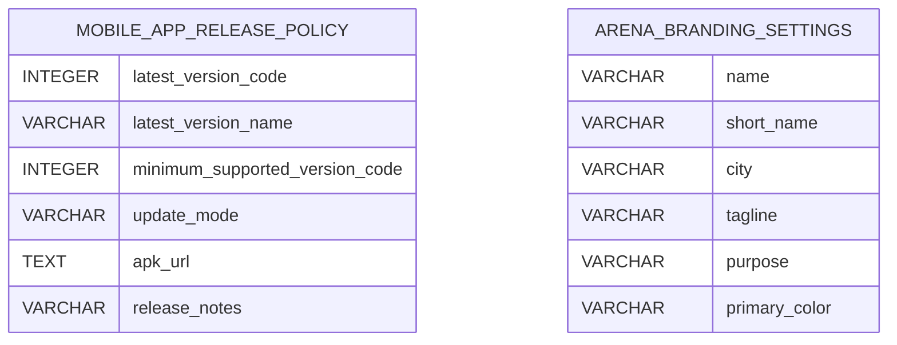

# PlayNexa schema migrations: Part 5
> Final 3 of 59 migration SQL files on `main`, 2026-11-09. **Not a live schema export**; shared SaaS production gate remains open.

## Files
- [`V58__facility_kannada_terms.sql`](../../apps/backend/src/main/resources/db/migration/V58__facility_kannada_terms.sql)
- [`V59__mobile_app_release_policy.sql`](../../apps/backend/src/main/resources/db/migration/V59__mobile_app_release_policy.sql)
- [`V60__playnexa_arena_branding_settings.sql`](../../apps/backend/src/main/resources/db/migration/V60__playnexa_arena_branding_settings.sql)

## Tables created

### `mobile_app_release_policy`
[SQL](../../apps/backend/src/main/resources/db/migration/V59__mobile_app_release_policy.sql)

| Column | Type |
|---|---|
| `latest_version_code` | `INTEGER` |
| `latest_version_name` | `VARCHAR` |
| `minimum_supported_version_code` | `INTEGER` |
| `update_mode` | `VARCHAR` |
| `apk_url` | `TEXT` |
| `release_notes` | `VARCHAR` |
| `updated_by` | `UUID` |
| `updated_at` | `TIMESTAMPTZ` |

### `arena_branding_settings`
[SQL](../../apps/backend/src/main/resources/db/migration/V60__playnexa_arena_branding_settings.sql)

| Column | Type |
|---|---|
| `name` | `VARCHAR` |
| `short_name` | `VARCHAR` |
| `city` | `VARCHAR` |
| `tagline` | `VARCHAR` |
| `purpose` | `VARCHAR` |
| `primary_color` | `VARCHAR` |
| `accent_color` | `VARCHAR` |
| `logo_url` | `VARCHAR` |
| `hero_image_url` | `VARCHAR` |
| `hero_video_url` | `VARCHAR` |
| `phone` | `VARCHAR` |
| `sports_csv` | `VARCHAR` |
| `revision` | `BIGINT` |
| `updated_by` | `VARCHAR` |
| `updated_at` | `TIMESTAMPTZ` |

## ADD COLUMN mutations
No matching ADD COLUMN statement.

See `pg_dump --schema-only` for authoritative physical model.
