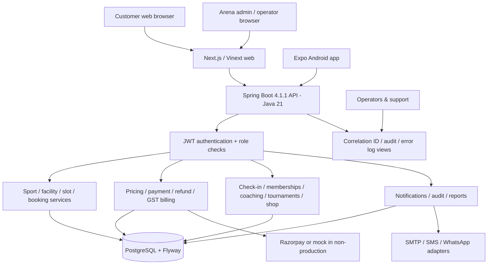
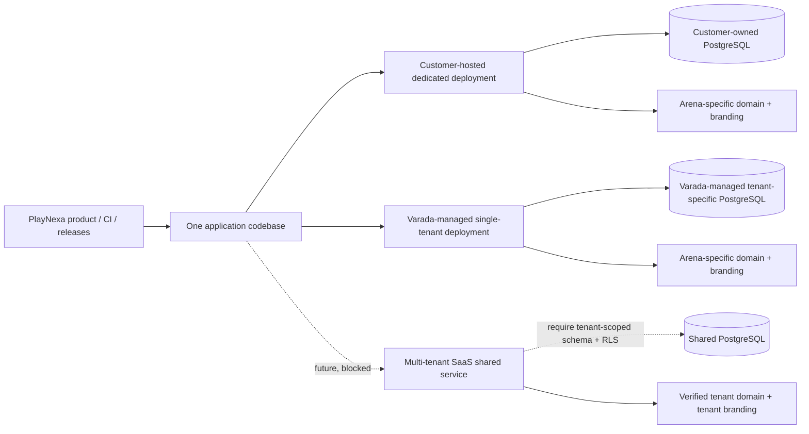
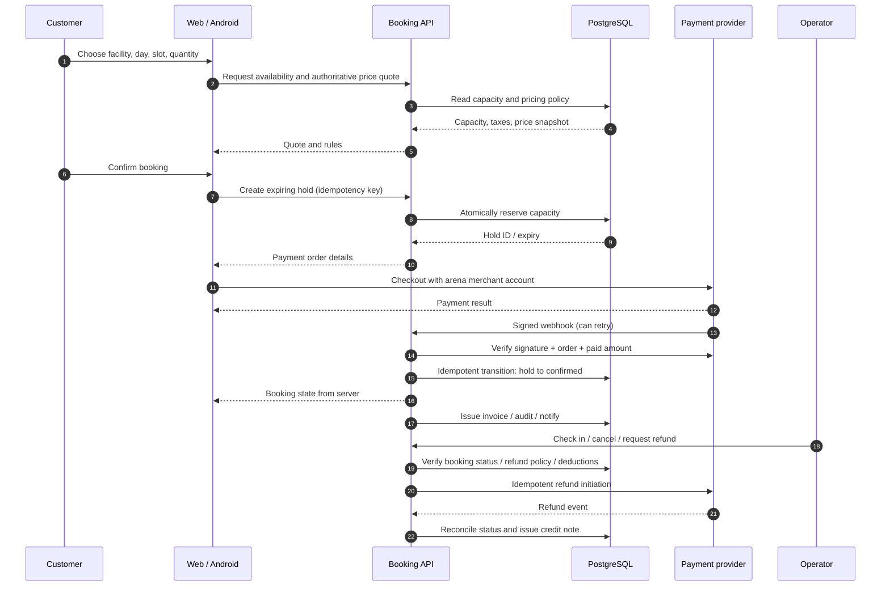

# PlayNexa system architecture and booking data flow

> Source-reviewed on 10 November 2026. Describes the imported Jnapanam application and the target SaaS model. A diagram is **not evidence of a deployed or UAT-certified system**.

## 1. Current implementation: modular monolith

**Observed modules:** identity/security, catalog/facilities, booking/slot holds, pricing, payment/refund, billing/tax, commerce, memberships, training, tournaments, loyalty, notifications, administration, events/content, player growth and operations. See source folders `apps/backend/src/main/java/com/jnapanam/sportszone` and web `apps/web/app`.

## 2. Hosting options use one product

Customer-hosted and PlayNexa-managed single-tenant use the **same complete booking/payment/operations product**, differing only in who hosts, backs up, monitors and maintains it. SaaS must preserve feature parity; it is **not enabled in the Java backend** until authenticated tenant isolation is implemented and tested.

## 3. Booking, payment and refund sequence

The sequence is the **required end-to-end contract**, not a claim that every event ordering has been verified in PlayNexa. Test success, failure, webhook-before-return, duplicate retries, hold expiry, cancellation and partial refund. Reconciliation must not infer booking success merely from a UI notification.

## 4. Trust boundaries

- All client input is untrusted: user/arena IDs, booking totals, availability, discount codes, device IDs and geolocation.
- Spring Security/JWT and role membership must protect each API. Arena host mapping alone is **not** tenant authorization.
- Database-level booking capacity constraints and versioned transitions prevent concurrent double booking.
- Webhooks require provider signatures, merchant/order/amount reconciliation and idempotency.
- OTP values, passwords, JWT, payment secrets, PAN, customer identity documents and request bodies **must not appear** in diagnostic logs.
- The current `SharedHostingSafetyGateFilter` returns HTTP 503 for non-health endpoints in SaaS mode. Do **not** bypass this check until every table, query, job, attachment, invoice and webhook is tenant-scoped.

## 5. Current versus target boundaries

| Domain | Source present | Dedicated deployment | Multi-tenant SaaS |
|---|---|---|---|
| Booking, courts, capacity | Yes, imported | Requires fresh customer UAT | Requires tenant isolation and UAT |
| Payment/refund | Yes, imported | Merchant/sandbox validation required | Tenant-merchant mapping and isolation not complete |
| GST/invoicing | Yes, imported | Registered legal identity required | Number sequence, taxes and documents must be tenant-scoped |
| Branding | Dedicated database row + admin UI | Available after migrations | Needs verified tenant settings store |
| Mobile | Expo source + build-time brand | New icon/package/signing and deep-link test | Universal app / tenant switching security not complete |
| Observability | Correlation + audit filter | Configure retention, alerts and support access | Must include trustworthy tenant context |
